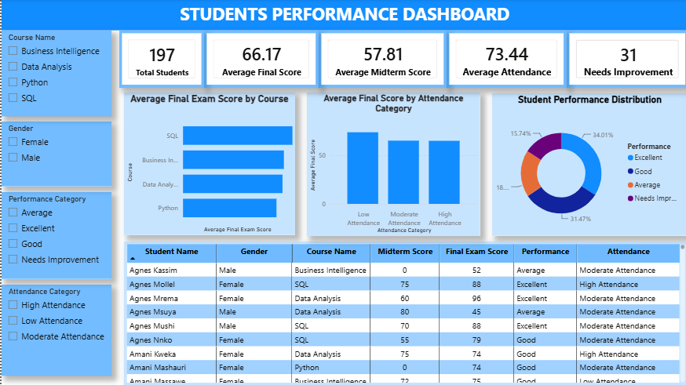

# Student Performance Analysis

## Project Overview
This project explores student academic performance using data analysis and visualization in Power BI. The aim is to understand students' performance levels, identify patterns and present insights that can support informed academic decision-making.

## Business Problem
Educational institutions need to understand how students perform academically to identify areas that require improvement and support better learning outcomes.

This analysis focuses on organizing student performance data into meaningful categories and presenting the results through interactive visualizations.

## Project Objectives
- Analyze student academic performance.
- Categorize students according to their scores.
- Identify performance patterns and trends.
- Present findings through clear and interactive dashboards.
- Generate insights that can support academic decision-making.

## Tools Used
- Power BI
- Microsoft Excel

## Performance Classification

Student scores are grouped into the following categories:

| Score Range | Performance Level |
|---|---|
| 80–100 | Excellent |
| 60–79 | Good |
| 40–59 | Average |
| Below 40 | Needs Improvement |

## Key Analysis Areas
- Overall student performance.
- Distribution of students across performance categories.
- Comparison of academic performance.
- Identification of areas requiring improvement.

## Dashboard Preview

The dashboard provides an overview of student academic performance,
including examination scores, attendance, performance distribution
and student-level records.

## Project Files

| File | Description |
|---|---|
| [Power BI Dashboard](Students-Performance.pbix) | Interactive student performance dashboard |
| [Dataset](Students.csv) | Dataset used for the analysis |
| [Dashboard Screenshot](Dashboard.png) | Visual preview of the dashboard |

## Download Project Files

- [Download Power BI Dashboard (.pbix)](Student-Performance.pbix)
- [Download Student Performance Dataset (.xlsx)](Students.csv)
 
## Key Insights

- The analysis covers 197 students.
- The average final examination score is 66.17.
- The average midterm score is 57.81.
- Average attendance stands at 73.44.
- 31 students are classified as needing improvement.
- Student performance varies across courses and attendance categories.

## Recommendations

Based on the analysis, the following actions are recommended:

- **Targeted Academic Support:** Provide additional academic support, tutoring and learning resources to students classified as needing improvement.
- **Monitor Student Attendance:** Strengthen attendance monitoring and identify students with low attendance for appropriate academic support.
- **Course-Level Performance Monitoring:** Review performance across different courses to identify subjects that may require additional learning interventions.
- **Continuous Performance Tracking:** Regularly monitor midterm and final examination results to identify performance gaps and track academic progress.
- **Data-Driven Decision Making:** Encourage educational institutions to use performance dashboards to support evidence-based academic planning and decision-making.

## Conclusion

The Student Performance Analysis project demonstrates how data analytics and visualization can be used to evaluate academic performance and generate meaningful insights.

The analysis covered 197 students, highlighting an average final examination score of 66.17 and identifying 31 students who need academic improvement.

Using Power BI, the project transformed student records into an interactive dashboard that makes it easier to explore performance patterns, compare results and identify areas requiring attention.

This project highlights the value of data-driven approaches in supporting academic monitoring, identifying improvement opportunities and making informed educational decisions.

---

**Author:** Stella Gendo  
**Field:** Data Analytics & Business Intelligence
